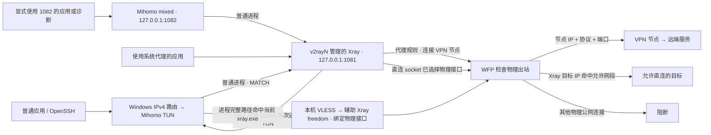

# V2RayN TUN Bridge

Windows x64 出站保护控制台。v2rayN 持有节点、路由和系统代理 `127.0.0.1:1081`。Bridge 为普通 IPv4 应用建立 Mihomo TUN，并用 Windows Filtering Platform（WFP）约束物理出口。界面显示最近观察到的 20 个应用及目标、Xray 直连规则、热点登录请求和工作日志。[English](README.md)

## 网络拓扑

- **入口。** 普通 SSH 使用 Windows 路由进入 TUN，无需改 SSH 配置。Mihomo 将普通流量送往 1081，由 v2rayN 决定代理或直连。1082 是 Mihomo 对外提供的本机诊断入口。系统代理应用可直接使用 1081。
- **避免回环。** 当 Xray 已经分流的连接又被 Windows 送回 TUN，Mihomo 按 Xray 可执行文件的完整路径选中物理出口。Bridge 使用同一安装目录里的 Xray 启动辅助进程，监听随机回环端口，使用每次运行生成的 VLESS 身份，并以 `sockopt.interface` 绑定启动时的物理网卡。物理 WFP 规则继续检查目标地址。普通 SSH 访问与 VPN 节点相同的 IP 时仍可进入 TUN，该节点的整条 IP 不做路由排除。
- **Wi-Fi 地址续租。** Windows DHCP 客户端通过物理网卡向 DHCP 服务器申请或续租地址。WFP 同时检查服务身份、可执行文件路径、网卡和 UDP 端口。IPv4 使用 68 → 67，IPv6 使用 546 → 547。
- **DNS 和地址族。** TUN 配置劫持 53 端口并使用 fake-IP，默认上游是经代理访问的 DoH。辅助 Xray 需要解析域名时，经 1081 访问 DoH。主 Xray 仍使用 v2rayN 生成的 DNS 配置。WFP 同时默认阻断 IPv4 和 IPv6 物理出站。当前 TUN 转发和节点发现按 IPv4 配置，IPv6 的保护与 IPv6 代理转发是两项独立能力。
- **直连边界。** 节点放行限定 Xray 程序、节点 IP、传输协议和端口。直连规则里作用于目标 IP 的条件（字面 IP、CIDR、`geoip:cn`）转成 Xray 专用 WFP 例外；同一条规则里同时写了 `domain` 不影响这份例外的提取，因为 Xray 在同一字段内取并集（`domain` 或 `ip` 命中即直连）。带 `source`、`inboundTag`、`user`、`protocol` 等非目标条件的规则不予转换，以免把条件放行放大成无条件放行。纯域名规则仍由 Xray 分流，但目标 IP 不在例外网段内时物理直连不会成功——因此直连策略里保留 `geoip:cn` 是必要的。网段规则按 IP 放行，DNS 服务商分类只用于显示。
- **局域网和热点。** 局域网例外限定当前物理接口、本地源地址及批准的在链地址范围，排除常用 DNS 端口。用户可以按 Wi-Fi 选择记住局域网配置。热点登录使用独立 Edge 配置和本机 PortalRelay，只有中继获得专用 DNS 和已批准目标 IP、端口的物理例外。关闭本次登录会话后收回这些例外。

## 启动与恢复

1. 下载并解压 Windows x64 发行包。安装带 Tk 的 **64 位 Python 3.11 或更新版本**，确保 `python` 在 PATH 中。热点登录需 Microsoft Edge。[发行版](https://github.com/seanzhang9999/V2RayN-TUN-Bridge/releases) 要让 TUN 转发 UDP，请在 **v2rayN 的 1081 本地 SOCKS/混合入站**启用 UDP 并应用设置。TCP 测速只验证 TCP；SOCKS5 的 UDP ASSOCIATE 返回状态码 7 时，监听器拒绝了 UDP 转发请求。
2. 先启动 v2rayN，使用 Xray 核心并确认本机 mixed/SOCKS 代理 1081 可用。双击 `guard-console.pyw`，或运行 `python -X utf8 guard-console.pyw`。首次选择包含 `v2rayN.exe`、`bin/Xray/xray.exe` 和 `binConfigs/config.json` 的安装目录。
3. 点「开启保护并启动 TUN」，批准 Windows 管理员提示。规则先安装，随后启动 TUN 并等待 WFP 确认新接口。点「停止 TUN」后物理出站保护继续生效；需要恢复正常 Windows 出站时再点「关闭保护」。关闭窗口后后台保护可以继续运行。
4. 通过「最近 20 个 TUN 目标」和「TUN 工作日志」核对连接。显式走 1081 的流量可能完全绕过 TUN 采样。故障时可重新打开控制台操作开关；会话状态和日志位于当前用户的 `%LOCALAPPDATA%\v2rayn-tun-controller`。

## 当前验证范围

在 Windows 手机热点环境下，出站保护与 TUN 同时开启时，已抓到 DHCP 请求和服务器回复，系统租约到期时间随之延后。两台 SSH 主机均完成新连接认证，Codex 已登录会话收到真实模型回复。观察时段、抓包结果及未覆盖场景见 [RC2 验证记录](docs/release-v0.3.4-rc.2.md)。

## 相关项目

- [managed-tun](https://github.com/seanzhang9999/managed-tun) — macOS 对应实现：v2rayN 之下的独立 sing-box TUN，
  用「事实 → 证据 → 诊断 → 动作」的可解释判据层定位故障，而不是靠状态字段反推。
